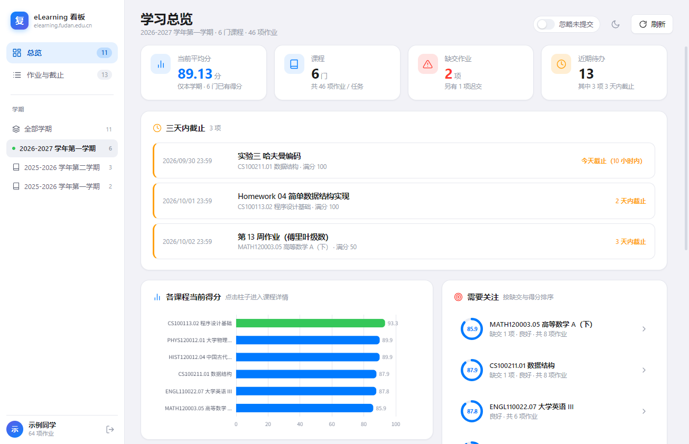

# 复旦大学 eLearning 学习看板

面向复旦大学 eLearning（Canvas）的非官方学习助手。使用复旦统一身份认证账号登录，集中查看课程、作业、成绩、截止时间和课程文件。

客户端直接连接学校的 UIS 与 Canvas 服务，不依赖自建中转服务器。可选的 AI 作业摘要使用你自行配置的模型服务。

## 客户端与当前开发方向

| 平台 | 技术 | 代码入口 | 说明 |
| --- | --- | --- | --- |
| iPhone / iPad | SwiftUI + Swift | [`flutter_app/ios/NativeRunner/`](flutter_app/ios/NativeRunner/) | 当前重点开发的原生客户端，最低 iOS 15 |
| Windows | Electron + React + TypeScript | [`src/`](src/) | 桌面学习看板 |
| Android / macOS | Flutter + Dart | [`flutter_app/lib/`](flutter_app/lib/) | Flutter 客户端 |

三套客户端对接相同的学校服务，分别实现认证、数据同步等逻辑，不共用一份业务代码。iOS 的独立工程位于 `flutter_app/ios/NativeRunner.xcodeproj`，构建不包含 Flutter 运行时。

## 主要功能

- **课程与学期**：按学期查看课程，浏览课程详情和历史数据。
- **作业与截止**：查看说明、提交状态、评分及截止时间，区分未交、已交待评分和已评分；可将作业标记为“无需提交”。
- **成绩看板**：展示 Canvas 成绩、作业分组得分和趋势；不提供教务成绩单或 GPA。
- **课程文件**：浏览文件树，下载单个文件、多选文件或整门课的文件。
- **本地缓存**：保留已同步的数据；默认优先刷新当前学期，复用已有历史课程数据。
- **可选 AI 摘要**：配置 OpenAI 兼容接口后生成作业简介；各端的展示和降级方式有所不同。

### iOS 原生体验

iOS 提供“今日、作业、课程、我的”四个标签页，支持作业月历、北京时间截止判定、每日汇总提醒、添加系统日历事件，以及 iPad 自适应列表与详情布局。界面使用系统控件，支持深浅色和动态字体。

提醒默认关闭，开启后根据已同步的数据安排。网页提交作业或截止时间变化后，需要重新同步。系统日历采用用户确认的单向添加，不自动更新或删除旧事件。



上图为 Windows 桌面端界面，不代表原生 iOS 的外观。

## 下载与安装

- [GitHub Releases](https://github.com/btr2309887446-code/fudan-elearning-dashboard/releases)：已发布版本的 Windows 安装包、iOS 未签名 IPA 和 macOS 应用。
- [GitHub Actions](https://github.com/btr2309887446-code/fudan-elearning-dashboard/actions)：查看构建结果，下载对应运行的产物；下载 Actions 产物通常需要登录 GitHub。

| 平台 | 安装方式 |
| --- | --- |
| Windows | 下载 `Fudan-eLearning-Dashboard-*-setup.exe` 后安装 |
| iPhone / iPad | 下载未签名 IPA，用支持的侧载工具自行签名安装，不能直接点击安装 |
| macOS | 解压应用后打开；当前构建未做公证，首次打开可能需要在系统中允许 |
| Android | 目前的发布工作流不生成 APK，需要自行构建 |

构建成功仅表示该版本通过对应构建流程，真实账号登录、校园网络及真机使用效果仍需实际验证。

## 本地开发

### Windows 桌面端

使用 Node.js 22.18 或更高版本（发布工作流使用 Node.js 24），在仓库根目录运行：

```powershell
npm ci
npm run dev
```

无需账号预览桌面界面：

```powershell
npm run demo
```

检查与打包：

```powershell
npm run typecheck
npm test
npm run dist
```

### iOS / iPadOS

在 Mac 上使用 Xcode 打开 `flutter_app/ios/NativeRunner.xcodeproj`，选择 `NativeRunner` scheme。真机运行需配置自己的签名。

Windows 可以编辑源码；iOS 编译和模拟器测试需要 macOS / Xcode，也可以使用仓库已配置的 GitHub Actions。完整步骤见 [iOS 原生客户端说明](docs/ios.md)。

### Android / macOS

在 `flutter_app/` 中使用 Flutter：

```bash
flutter pub get
flutter run --dart-define=DEMO=true
```

上述演示模式展示 Flutter 客户端，不代表原生 iOS。平台构建与路径注意事项见 [Flutter 客户端说明](flutter_app/README.md)。

## 仓库结构

```text
src/                         Windows Electron / React / TypeScript 客户端
cli/                         桌面端协议诊断、数据导出和回归测试
flutter_app/
  lib/                       Android / macOS Flutter 客户端
  test/                      Dart 逻辑、界面和截图测试
  ios/
    NativeRunner/            当前 iOS / iPadOS SwiftUI 客户端
    NativeRunner.xcodeproj/  独立原生 Xcode 工程
    NativeRunnerTests/       原生单元测试
    NativeRunnerUITests/     原生界面测试
    Runner* / Flutter/       保留的旧 Flutter iOS 工程
  android/                   Android 工程
  macos/                     macOS 工程
.github/workflows/           持续集成和发布
scripts/                     打包与跨端登录诊断脚本
recon/                       协议研究、图标生成和历史维护脚本
build/                       版本控制中的应用图标及源图
docs/                       使用说明、截图与历史文档
ios-labbook/                独立 iOS 实验项目，不参与 eLearning 构建
```

`artifacts/`、`out/`、`release/` 及安装包属于本地产物，不纳入版本控制。旧 Flutter iOS 工程和独立实验源码保留用于参考，当前 iOS 开发入口以 `NativeRunner` 为准。

## 文档导航

| 文档 | 内容 |
| --- | --- |
| [iOS 原生客户端](docs/ios.md) | 功能、源码分工、构建测试、提醒与日历限制 |
| [Windows 桌面端](docs/desktop.md) | 详细功能、使用设置、认证流程、命令行工具与常见问题 |
| [Flutter 客户端](flutter_app/README.md) | Android / macOS 开发、测试和构建注意事项 |
| [图标与视觉资源](docs/assets.md) | 图标生成、资源位置与平台差异 |
| [历史 Flutter 开发记录](docs/archive/flutter-notes.md) | 早期实现和环境排错记录，部分信息已过时 |
| [独立 iOS 实验项目](ios-labbook/README.md) | 实验代码的定位及早期装机笔记 |

## 登录、数据与隐私

登录通过学校的 UIS / CAS 流程完成，密码按学校接口要求加密提交。支持验证码预检；需要额外二次验证的账号暂不支持完整登录流程。

- 密码默认不持久化；选择记住密码后，由对应平台的系统安全存储保存。iOS 使用 Keychain，Windows 使用 Electron `safeStorage`。
- 会话 Cookie、课程快照和偏好保存在本机。登录过期后需要重新认证，已有缓存可用于查看。
- 启用 AI 摘要后，作业标题与说明文本会发送到你配置的模型接口；是否启用由你决定。
- 不要向仓库提交账号密码、Cookie、个人快照、验证码或未经检查的诊断输出。

本项目为个人学习用途的非官方工具，与复旦大学信息化办公室无关联。课程数据以学校 eLearning 为准；正式成绩请通过教务系统查询。请遵守学校信息系统使用规定，避免高频请求。
