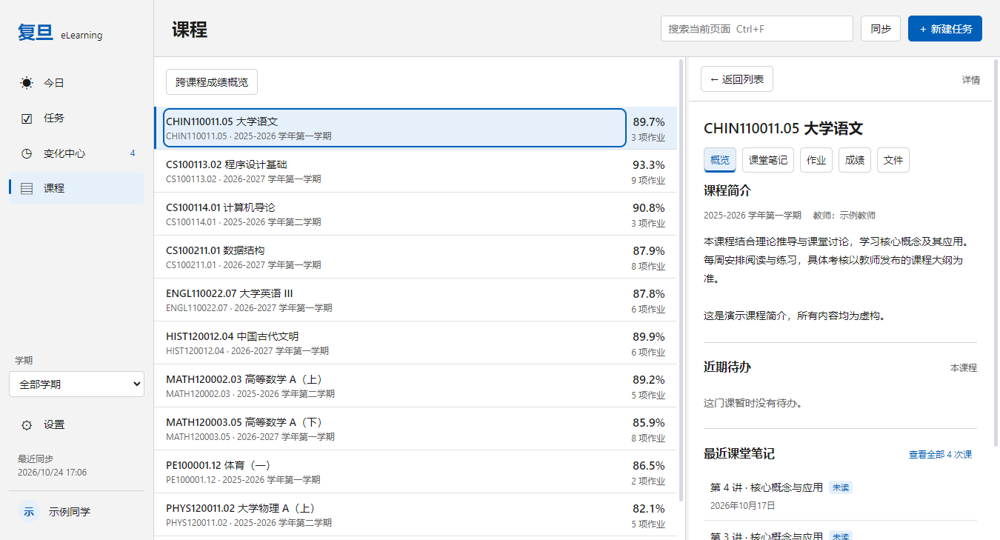
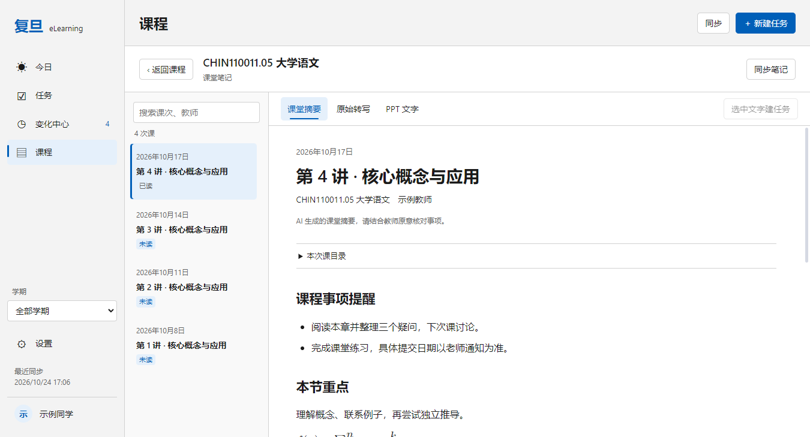

# Windows 课堂笔记（0.11.0）

[返回桌面说明](desktop.md)

课程页默认展示概览，包含 Canvas 提供的课程简介、教师、近期待办和最新三次课堂笔记。课堂笔记直接读取订阅仓库的数据分支，不读取邮箱，也不改变邮件发送流程。此版本不控制订阅或生成任务，不额外调用 AI。

## 首次连接

1. 登录看板，打开「设置 → 课堂笔记」。默认来源是 `btr2309887446-code/Fudan_iCourse_Subscriber` 的 `data` 分支。
2. 输入生成这些笔记时使用的学号和 UIS 密码来解锁。若生成时使用的是旧密码，需要对应的旧密码。本次输入用于本地派生解密密钥，不用于重新生成内容。
3. 默认仅本次解锁。「在本机记住」会使用 Windows 安全存储保护派生密钥。公开仓库不需要令牌；私有仓库需要能够读取该仓库内容的令牌。
4. 为待关联的 iCourse 课程选择 Canvas 课程并确认。名称、教师和学期只用于辅助推荐，不会自动绑定；也可以粘贴 iCourse 课程链接查找。
5. 返回课程，打开「课堂笔记」。一门 Canvas 课程可以关联多个 iCourse 课程；同一个 iCourse 课程只能关联当前账号的一门 Canvas 课程。

首次关联导入历史内容时不产生变化消息。重新关联也会建立新的基线，避免历史笔记刷屏。

## 阅读与待办

课次列表支持按标题、日期、课程或教师搜索，每页 50 条。正文分别展示课堂摘要、原始转写和 PPT 识别文字；摘要支持公式、表格与目录。原始 HTML 不执行，图片不从外部自动加载，链接通过系统浏览器打开。

摘要中的事项或正文选中文字可以「加入个人任务」。编辑器预填课程、事项和来源课次，截止日期留空，由用户确认。保存失败会保留草稿；保存后可查看任务，并从任务返回原笔记。不会改动学校作业的截止时间。

返回课程或再次进入阅读器，会在当前应用会话内恢复课次、阅读页签和滚动位置。已读状态保存在本机，摘要更新后会重新标记待阅读。

## 同步与本地数据

笔记同步遵循现有自动同步间隔，也可以在阅读器中单独同步。上游生成并提交后，下次成功同步才会显示。学校登录失效与笔记源故障分别处理。

当前支持订阅仓库的版本 4 加密索引与数据库分片。主进程的工作线程负责解密和 SQLite 查询；列表不携带全文。下载按分片哈希复用缓存，错误密码、断网或部分分片失败时保留上次成功内容。解锁后可以离线阅读已缓存笔记。

本地数据位于应用数据目录的 `classroom` 下，按学校账号和仓库来源隔离。磁盘缓存保留上游加密文件，全文只在解锁后的工作线程中读取；阅读标记、课程关联和索引元数据单独存储。退出账号或切换来源会取消旧请求。个人任务中的来源、阅读状态不跨设备同步。

变化中心只保存课次身份与摘要指纹；新增或修改摘要会生成记录，打开后直接阅读对应课次，不展示指纹或冒充全文差异。

## 验证记录（2026-10-24）

- 类型检查、完整 `npm test` 通过。课堂内容新增 36 项检查，覆盖加密兼容、错误密码、离线恢复、部分失败、账号切换、分片迁移、重复同步、重新关联和 5,000 条分页搜索。
- 新界面覆盖概览、摘要/转写/PPT、公式、任务保存失败后重试、来源返回、已读、课程关联和变化跳转。检查浅/深色、800×600 窗口、1366/1920 宽度以及 125%/150% 缩放。
- 原工作区 12 组界面回归通过，包括任务、月历、变化、课程、减少动态效果和 5,000 项任务操作。
- 已生成 Windows x64 NSIS 安装包，并用打包后的可执行文件验证工作线程、SQLite WASM、阅读与公式渲染。
- 测试与截图全部使用虚构账号和合成加密数据。真实订阅账号的首次解锁、学校课程大纲可用性及私有仓库令牌尚未现场验证；安装后的系统通知与睡眠唤醒不属于本轮新增验证结果。

运行演示：`npm run demo`。课堂界面回归：`npm run test:course-ui`。演示模式与正式账号数据隔离。

