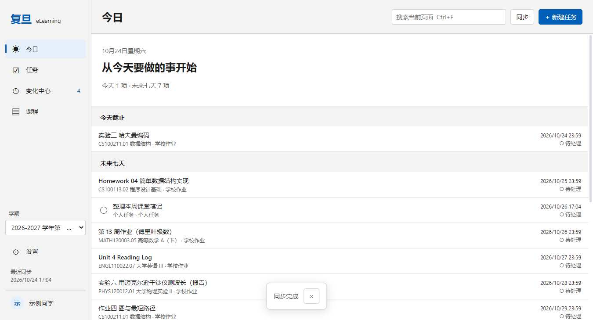
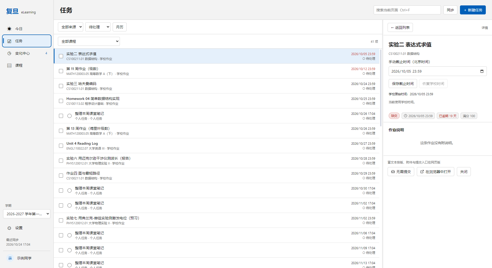
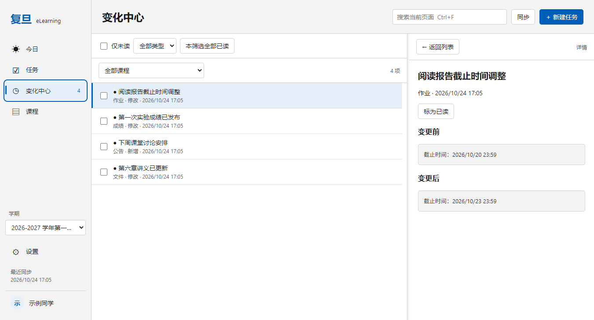

# Windows 桌面工作区

[返回项目首页](../README.md)

0.11.0 使用 Electron、React 和 TypeScript，保留系统标题栏、现有安装方式及学校登录流程。首页先展示待办和课程变化，课程页增加概览和课堂笔记。连接步骤和本轮验证范围见 [课堂笔记说明](classroom-notes.md)。

## 页面与操作

| 页面 | 内容 |
| --- | --- |
| 今日 | 今天截止、未来七天、折叠逾期、最近变化 |
| 任务 | 学校作业和个人任务；来源、状态、课程、搜索筛选；列表和月历 |
| 变化中心 | 作业、成绩、公告、文件和课堂摘要的新增/修改；筛选和批量已读；课堂记录直接进入笔记 |
| 课程 | 概览、课堂笔记、作业、成绩、文件；跨课程成绩概览 |
| 设置 | 课堂笔记连接与课程关联、外观、同步间隔、托盘、两类通知、下载目录、摘要服务、账号 |

宽窗口显示导航、列表和详情三栏；详情边界可拖动，也可 Tab 聚焦后用左右方向键调整。960–1199px 折叠导航，800–959px 使用列表/详情切换。工具栏固定，列表与详情独立滚动。支持浅色、深色和跟随系统。

- `Ctrl+N`：新建个人任务。
- `Ctrl+F`：聚焦当前页搜索。
- `Ctrl+R`：全量同步，包括历史课程。
- `Esc`：关闭详情或取消选择。

输入框中的组合键保留文本编辑用途；新建、编辑、删除使用支持焦点约束的原生对话框。普通详情不弹出浮层。

## 任务

学校作业可以添加手动截止时间，影响本机排序、月历和提醒；学校原始时间始终保留。“恢复学校时间”使用最近一次成功同步的原始时间。提交仍需前往 eLearning 网页。

个人任务包含备注、可选课程/日期、一级子任务、完成状态、每日/每周/每月重复、结束日期和最多五个提前提醒。日期按北京时间处理。每个期次独立完成和勾选，保留逾期；重复任务编辑、删除时选择“仅本次”或“本次及以后”；月末缺失的日期取当月最后一天。

列表默认显示待处理，状态筛选可查看全部、已完成、逾期或无需提交。多选个人任务可以完成/删除，多选学校作业可以标记无需提交。混合来源时不显示不兼容的批量操作。个人任务和本地标记不改变课程成绩。

重复任务列表默认展开未来 90 天和全部既往期次；月历切换到更远月份时扩展范围。长列表按 100 条分段加载。

## 变化与同步

首次成功同步每门课的每类资源只建立基线；以后记录新增和修改。不根据消失推断删除，不因失败或历史缓存复用推进基线。成绩零分和撤回均可记录。事件保留最近 180 天、最多 2,000 条。

运行期间默认每 15 分钟检查未结束学期，可关闭或调整为 30/60 分钟；历史课程缓存缺失时也会请求。手动同步覆盖全部学期。网络刷新串行；课程作业请求失败时保留上次成功数据，并显示失败说明。登录失效后本地任务仍可使用，在设置中重新登录。

## 托盘与提醒

关闭窗口后留在托盘默认关闭，开启后首次关闭会说明后台仍在运行。托盘菜单提供打开、立即同步、暂停提醒和退出；真正退出停止同步与提醒，不添加开机自启。

任务提醒、变化通知分别默认关闭。学校作业默认提前一小时，个人任务使用自己的提醒设置。变化通知每次同步仅汇总一条。睡眠期间不保证送达，唤醒后合并最近 24 小时未发出的任务提醒；同一任务在汇总中只出现一次。点击通知会核对账号后恢复窗口并定位任务或变化批次。

系统通知的实际展示、通知中心点击和物理睡眠唤醒仍需在安装后的 Windows 桌面确认；开发目录运行的结果不能替代这项验收。

## 数据与升级

扩展数据存储在应用数据目录的 `accounts/workspace-<学校账号ID>.json`，按账号隔离、带版本号。主进程先写入临时文件、保留上一版 `.bak`，再替换正式文件；写入失败不确认保存成功。

主题、下载目录、摘要配置和旧设置保留。旧首页板块设置不再影响今日页。旧版无账号归属的标记保留在旧偏好中，不自动归入当前账号。Windows 与 iOS 不共享存储文件，不跨设备同步。

演示模式使用独立临时目录和虚构账号，截图不会使用真实账号。不要用演示模式保存正式任务。

## 截图

以下为真实 Electron 窗口中的演示数据。






## 开发、检查与安装包

```powershell
npm ci
npm run dev
npm run demo
npm run typecheck
npm test
npm run test:workspace-ui
node scripts/test-workspace-lifecycle.mjs
npm run dist
```

安装包输出到 `release/Fudan-eLearning-Dashboard-0.11.0-setup.exe`。领域测试包括重复规则、账号隔离、写入失败、缓存恢复和 5,000 项任务；UI 测试使用独立演示目录，覆盖新建/完成/删除、学校截止覆盖、多种尺寸及缩放。课堂笔记检查使用 `npm run test:course-ui`。共享日期用例在 `fixtures/task-recurrence.json`，由 TypeScript 和 Swift 测试读取；Swift 测试需 macOS/Xcode。

本次验收记录见 [Windows 工作区验证](windows-workspace-validation.md)。

## 登录说明

应用使用**学号 + 统一身份认证密码**登录，走的是学校认证服务器的标准流程：

```
elearning.fudan.edu.cn/login/cas
  → id.fudan.edu.cn/idp/authCenter/authenticate
  → 获取 RSA 公钥 → 查询认证方式 → 提交加密后的密码
  → 换取服务票据 → 回到 eLearning，拿到 Canvas 会话
```

密码用 RSA（PKCS#1 v1.5）加密后提交，与学校登录页面自身的行为一致。

### 关于密码安全

- 密码**默认不写入磁盘**，只用于当次登录的内存中。
- 勾选「记住密码」后，密码会用 **Windows DPAPI**（`safeStorage`）加密后保存在本机用户目录，
  只有当前 Windows 用户能解密。可随时点「退出」清除。
- 登录和课程同步请求发往学校服务；启用 AI 摘要后，作业标题与说明还会发送到你配置的模型接口。会话 Cookie 保存在本机，供后续刷新使用。
- 渲染进程（界面）**无法直接访问网络或 Cookie**，所有请求都由主进程完成。

### 关于登录次数被锁定

学校认证服务器在多次密码错误后会要求验证码，甚至临时锁定账号。为避免白白消耗尝试次数，
本应用在**提交密码之前**会先调用认证服务器的 `verifyCodeIsNeed` 接口确认是否需要验证码：

- 若不需要 → 正常提交；
- 若需要 → 弹出验证码图片让你填写（和学校登录页一样），而不是直接失败一次。

如果账号已被锁定，请等待自动解锁或联系信息办。

---

## 命令行工具

除了图形界面，仓库里还有两个可直接用 `node` 运行的小工具，方便排查问题和导出数据。

### 1. 链路自检（不需要密码）

在提交任何凭据之前，验证整条认证链路是否仍然可用：

```powershell
npm run doctor
```

它会检查：eLearning 可达性、Canvas 实例识别、CAS 跳转链、IdP 参数解析、
RSA 公钥获取与加密、可用认证方式、以及离线的 HTML/Cookie 解析单元测试。

**登录失败时请先跑这个**，它能区分「学校改了认证流程」和「你的密码不对」。

### 2. 缓存兼容性测试（不需要密码）

```powershell
npm run test:cache
```

校验本地缓存的形状处理：旧版本写的缓存能否被安全升级、损坏的缓存是否会被拒绝而不是半信半疑地使用，
以及本机真实缓存文件能否正常读取。这一类问题不会报错，只会让界面白屏，所以用测试钉死。

### 3. 数据快照导出

```powershell
npm run cli                      # 交互式输入学号密码
npm run cli -- --reuse           # 复用已保存的会话
npm run cli -- --out data.json   # 指定输出文件
npm run cli -- --active          # 只取当前学期在修的课程
```

会在终端打印各科得分表，并把完整数据写入 `snapshot.json`（含每一条作业的得分与截止时间）。
若认证服务器要求验证码，它会把验证码图片存成 `captcha.png` 并尝试打开，然后让你输入。

---

## 项目结构

```
src/
  core/                 # 与界面无关的核心逻辑，可直接用 node 运行
    cookies.ts          #   自实现的 Cookie 容器（跨域登录链必需）
    http.ts             #   带 Cookie 与手动重定向的 fetch 封装
    uis.ts              #   复旦统一身份认证登录（对标 IdP 前端真实实现）
    canvas.ts           #   Canvas REST 客户端（含 Link 头分页）
    scoring.ts          #   纯成绩计算：加权、分组达成度、趋势
    aggregate.ts        #   拉取并组装快照
    session.ts          #   会话（仅 Cookie）持久化
    demo.ts             #   演示数据（仅供预览）
    errors.ts, types.ts
  main/index.ts         # Electron 主进程：窗口 + IPC + 所有网络请求
  preload/index.ts      # contextBridge 安全桥接
  renderer/             # React + ECharts 界面
cli/                    # 命令行工具（doctor / snapshot）
recon/                  # 协议侦察脚本与抓取的响应（开发用）
```

### 为什么网络请求放在主进程

Canvas 不返回 CORS 头，浏览器环境下的渲染进程无法直接请求；
更重要的是，让会话 Cookie 留在主进程可以确保它永远不会暴露给页面内容。

---

## 技术栈

- **Electron 33** + **electron-vite** + **Vite 5**
- **React 18** + **TypeScript** + **ECharts**
- **electron-builder** 打包为 NSIS 安装包
- 密码加密使用 Node 内置 `crypto`（RSA PKCS#1 v1.5），无额外加密依赖

---

## 常见问题

**Q：打开后是空白窗口，看不到登录界面？**
这是 0.3.0 及更早版本的一个 bug，**0.4.0 已修复**。原因是旧版本写下的本地缓存缺少新版本需要的字段，
读取时让整个界面崩掉了。现在每次读缓存都会先做形状校验和补全，无法修复的缓存会被丢弃并重新拉取。
如果你还在用旧版，装 0.4.0 即可；界面上万一再出现渲染错误，现在会显示可读的错误信息和
「清除本地缓存并重新加载」按钮，而不是一片空白。

**Q：提示「登录状态已失效」？**
Canvas 会话有过期时间。重新登录即可，已同步的数据仍可查看。

**Q：某些课程没有得分？**
如果老师还没有批改任何作业，Canvas 本身就没有分数可算，显示为「暂无」是正常的。

**Q：作业列表是空的？**
Canvas 只返回**已发布**的作业。若老师把作业设为未发布，学生端看不到，本应用也拿不到。

**Q：能查成绩单 / GPA 吗？**
不能。本应用只读 eLearning（Canvas）里的教学数据，不含教务处的正式成绩。
官方成绩请查 eHall。

**Q：为什么未登录时接口报错是阿拉伯语？**
该 Canvas 实例的匿名默认语言被设成了 `ar_SA`。本应用的所有请求都显式带 `Accept-Language: zh-CN`，
登录后界面语言以你自己的 Canvas 设置为准。

---

## 免责声明

本项目为个人学习用途的非官方工具，与复旦大学信息化办公室无关联。
它只读取你自己账号本来就能在网页上看到的数据，不修改任何内容。
请遵守学校的信息系统使用规定，不要高频轮询接口。
