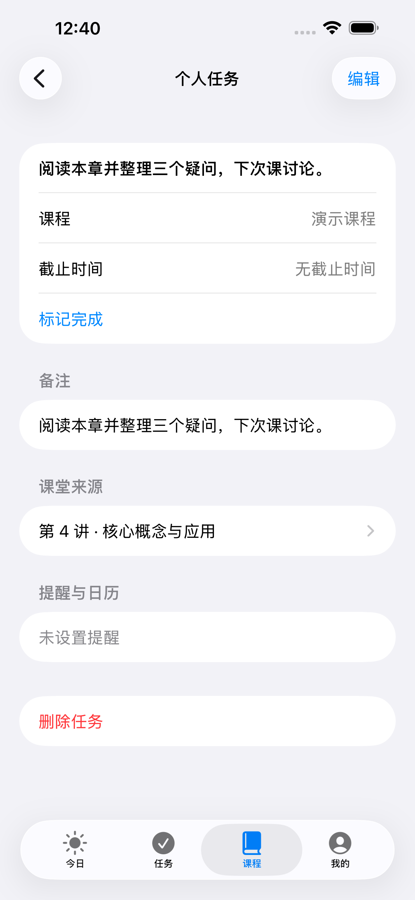
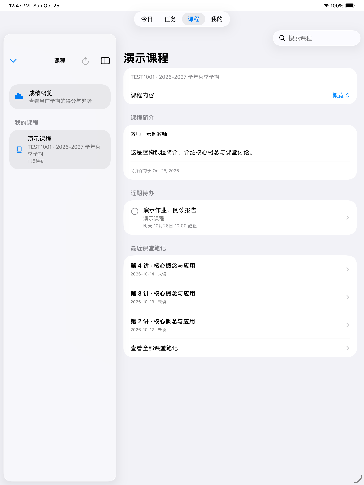
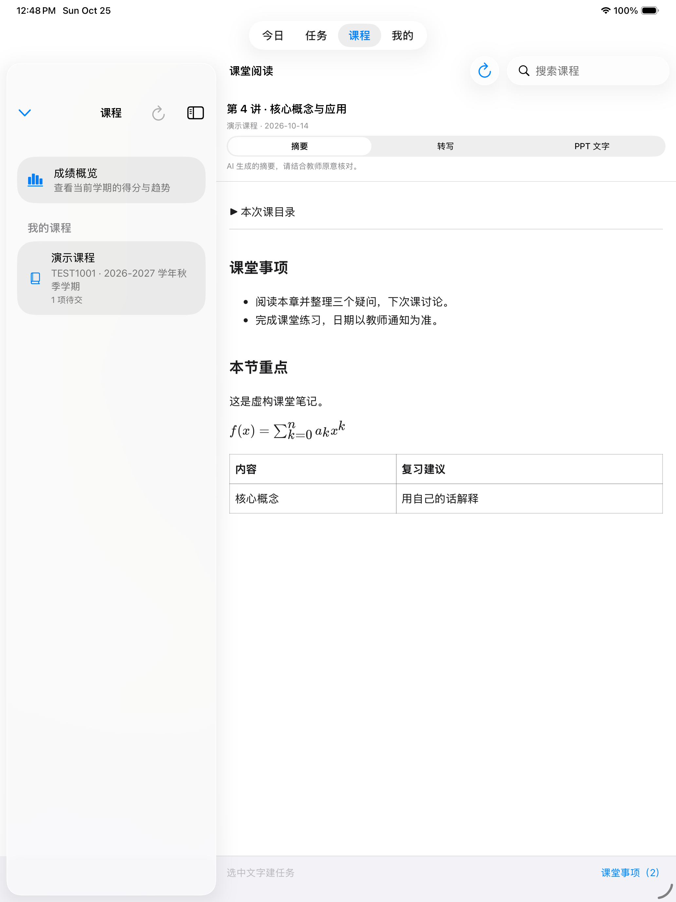
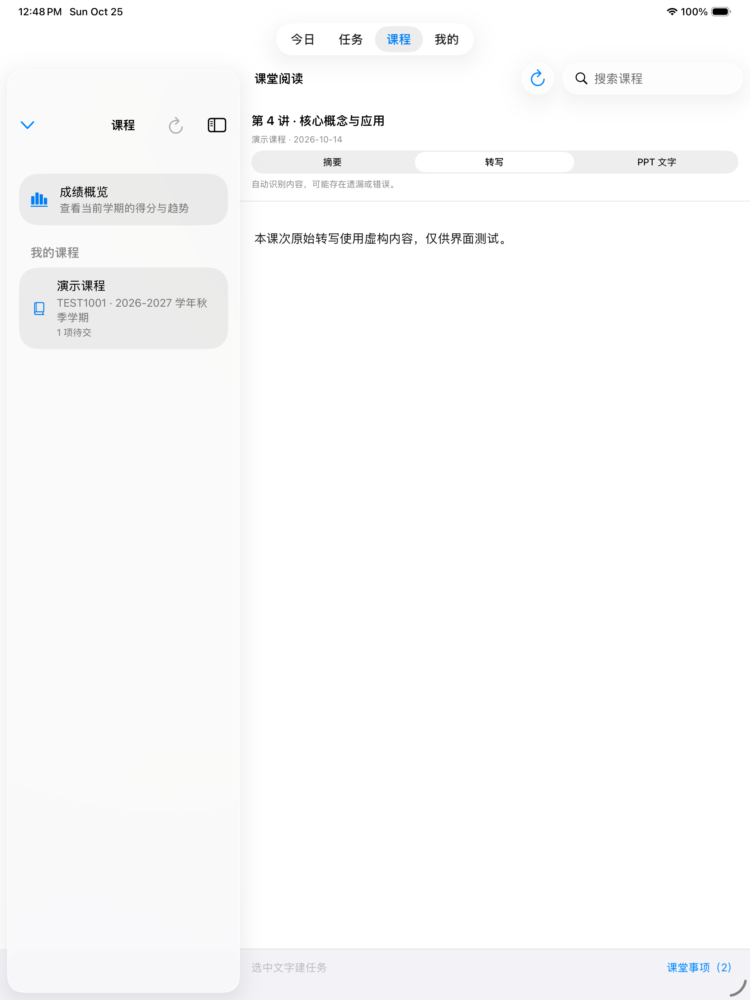

# iOS 课堂内容整合

原生 SwiftUI 客户端直接读取 iCourse Subscriber 的版本 4 加密索引、gzip SQLite 分片，与 Windows 使用同一上游数据协议。没有新增订阅控制、邮件读取或 AI 生成请求。

## 实现

- `LectureDomain.swift`：稳定课次身份、加密格式、解压、SQLite 索引和正文查询。
- `LectureService.swift`：GitHub 提交固定下载、哈希缓存、课程绑定、读取状态和钥匙串。
- `LectureStore.swift`：账号切换取消、前台状态、变化记录及 Canvas 简介缓存。
- `LectureViews.swift`：概览、分页列表、阅读器、连接表单与课程关联。
- `lecture-reader.html`：随包提供的离线 Markdown / KaTeX 阅读组件，禁止联网、原始 HTML 和远程图片。

解密、解压和数据库访问在独立 actor 上执行。解密后的 SQLite 通过系统文件保护的临时文件导入内存，关闭源文件后立即移除临时文件；启动时清理中断遗留的临时文件。长期磁盘缓存只保存加密分片，连接元数据单独原子写入。记住的派生密钥采用 `WhenUnlockedThisDeviceOnly` 钥匙串保护，原始 UIS 密码不写入缓存。

课堂任务来源是可选字段，旧任务文件仍可解码。变化记录保存摘要 SHA-256 指纹，详情不展示指纹，也不伪造全文差异。

## 本地与 CI 检查

`LectureTests` 使用 Node 生成的合成加密夹具，验证跨语言解密、错误密码、5,000 条课次、旧任务兼容、分页、离线解锁、已读保存、写入失败、账号隔离、静默基线和重复同步。`LectureUITests` 在演示账号上检查概览、三个阅读页签、任务草稿、保存及来源入口。

离线阅读资源可使用 `node scripts/build-ios-lecture-reader.mjs` 重新生成，夹具使用 `node scripts/build-ios-lecture-fixture.mjs` 生成；需要根目录中对应的 React、react-markdown、remark-gfm、remark-math、rehype-katex、KaTeX、esbuild 和 sql.js 开发依赖。生成的资源已入库，Xcode 构建无需 Node 或运行时下载。

Windows 上的 `scripts/test-ios-reader.cjs` 通过 Electron 检查共享网页组件的公式、表格、目录、文本安全、离线资源、主题与字号；它不替代 WKWebView 和 iOS 原生界面的验证。

专用工作流 `.github/workflows/ios-classroom.yml` 在 macOS 上执行 iPhone 15 Plus / iOS 26 和 iPad 测试，导出模拟器截图，再构建未签名 IPA。未签名 IPA 需要自行签名后侧载到手机。真实账号解锁、学校大纲内容、私有仓库令牌和真机长时间使用需要实际验证，演示截图不能当作真机截图。

阅读器在 WebKit 启动及正文提交期间显示加载提示；导航失败、脚本错误或网页进程中断时提供重新加载入口。切换页签时只采用最新一次渲染的结果，退出页面后不再更新状态。

## 连接与重试

| 情况 | 检查方法 |
| --- | --- |
| GitHub 网页可打开，笔记仍无法同步 | 笔记通过 `api.github.com` 读取，网页与 API 的连通情况可能不同；网络恢复后在笔记连接页重试同步 |
| 解锁失败 | 使用生成这些加密数据时的学号和 UIS 密码；修改了 UIS 密码不会自动重加密旧数据 |
| 已连接但课程中没有笔记 | 在连接页确认 iCourse 与 eLearning 的课程关联，再查看该课程的课堂笔记 |
| 在线同步失败 | 已成功缓存的内容继续保留；若未记住解锁信息，重新进入应用后需再次解锁 |
| 正文加载失败或阅读组件中断 | 使用正文区域的「重新加载正文」；它只重建本地阅读组件，不重新生成摘要 |

## 2026-10-25 验证

[构建 40193414984](https://github.com/btr2309887446-code/fudan-elearning-dashboard/actions/runs/40193414984) 对提交 `48343c3` 完成以下检查，产物于 2026-10-26 下载核对：

| 环境 | 结果 |
| --- | --- |
| iPhone 15 Plus / iOS 26.5 模拟器 | 35 项核心测试和 1 条完整课堂阅读、建任务流程通过 |
| iPad Pro 13-inch (M5) / iOS 26.5 模拟器 | 同样 36 项通过 |
| Windows 本地离线阅读组件 | 8 项检查通过，覆盖公式、表格、目录、安全文本、主题和字号 |
| iPhone / iPad Release 构建 | 生成未签名 IPA，版本 1.2.0 (6)，最低 iOS 15 |

核心测试使用合成的 5,000 条课次夹具，覆盖兼容解密、错误密码、损坏分片保留、分页搜索、离线解锁、账号隔离、已读保存失败和变化基线。界面测试确认摘要、转写、PPT 页签、连续切换、任务预填、默认无截止时间和任务来源入口。本轮没有使用真实账号执行解锁，也没有真机测试；深色和字号只在本地阅读组件中自动检查，不代表完整原生界面已逐项验证。

构建产物 `ios-classroom-delivery` 仅包含安装包和截图；`ios-classroom-results` 另含完整测试结果。两者默认保留 14 天。最终交付的安装包大小为 3,979,219 字节，SHA-256 为 `210141723b681ba6a6e7ed15e2cd96618ab1525953e59bbf1de6a167a1398ae3`。

界面测试首次等待真实正文出现，允许托管模拟器的 WebKit 冷启动最多 90 秒；后续切换仍采用较短等待。截图额外等待合成帧稳定，已人工核对 iPhone 和 iPad 的摘要、公式、表格，以及 iPad 连续切换后的正文，未使用空白帧作为预览。

## 界面预览

以下截图来自上述模拟器测试，全部使用虚构课程、教师、课堂笔记和个人任务。

| iPhone 课堂摘要 | iPhone 任务来源 |
| --- | --- |
|  |  |

