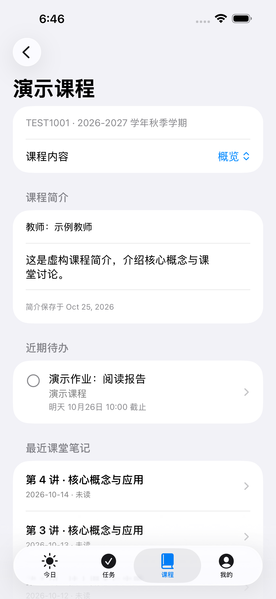
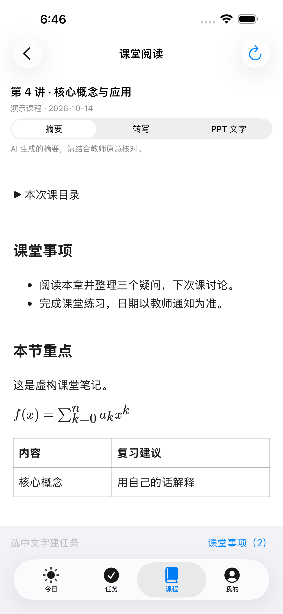
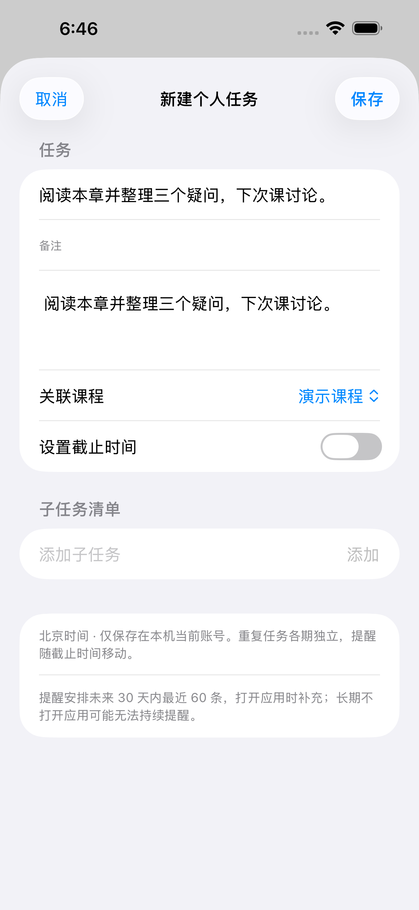

# iOS / iPadOS 原生客户端

[返回项目首页](../README.md)

当前 iOS 客户端使用 SwiftUI / Swift，最低支持 iOS 15。工程为 [`../flutter_app/ios/NativeRunner.xcodeproj`](../flutter_app/ios/NativeRunner.xcodeproj/)，独立构建，不依赖 Flutter 运行时。

## 功能与使用

| 入口 | 功能 |
| --- | --- |
| 今日 | 汇总学校作业与个人任务，显示变化中心未读数及最近变化 |
| 任务 | 学校/个人来源筛选、搜索、列表与北京时间月历，管理个人任务和学校作业 |
| 课程 | 课程概览、课堂笔记、作业、成绩趋势、分组得分与文件下载 |
| 我的 | 课堂笔记连接、登录与退出、外观、同步范围、通知开关、摘要配置与诊断日志 |

作业详情可将作业标记为“无需提交”，从待交任务与提醒中移除，不改变成绩计算。提交仍需前往学校 eLearning；客户端提供跳转入口。

作业详情支持“设置手动截止时间”，适合学校未填写截止字段、但在正文中说明了期限的作业。日期和时间按北京时间选择，保存后用于今日页、列表排序、月历、已开启的提醒和系统日历导出。手动时间按账号保存在本机，同步后保留，不修改学校记录，也不在设备间同步；可以随时修改或清除。清除后恢复最新同步的学校截止时间，没有学校时间则恢复为“无截止时间”。已有的系统日历事件仍需手动更新。

课程文件支持单个、多选及整课下载，按 `学期 / 课程 / Canvas 子文件夹 / 文件名` 保存到应用文档目录的 `eLearning/` 下。工程开启了文件共享，可通过系统“文件”App 访问。

## 课程概览与课堂笔记

课程详情默认进入概览：显示 Canvas 提供的课程简介和教师、近期待办，以及最近三次课堂笔记。通过「课程内容」菜单切换概览、课堂笔记、作业、成绩和文件。

在「我的 → 课堂笔记连接」中连接 `btr2309887446-code/Fudan_iCourse_Subscriber` 的 `data` 分支，使用**生成笔记时的学号与 UIS 密码**解锁。公开仓库不需要令牌；私有仓库需只读内容权限的 GitHub 令牌。默认只在本次运行解锁；选择记住后，派生密钥保存在此设备的 iOS 钥匙串中。

解锁后手动确认 iCourse 与 eLearning 的课程关联。可按课程名称、教师、学期搜索，也可粘贴 iCourse 课程链接。一门 eLearning 课程可关联多门 iCourse 课程，每门 iCourse 课程只关联当前账号的一门课。同名和跨学期课程不会自动绑定。

课次列表每页 50 条，支持标题、日期和教师搜索。阅读器区分摘要、原始转写和 PPT 文字，支持公式、横向滚动表格、目录、文字复制、深浅色和系统字号。阅读所需资源随应用打包；正文中的原始 HTML 不执行，也不自动加载远程图片。

点击「课堂事项」或选中文字后「建任务」，打开现有个人任务编辑器，预填课程、文字与来源课次；截止日期默认关闭，由用户确认。任务保存后可以查看，并从任务的课堂来源返回笔记。旧任务保持兼容，账号切换后不能把旧草稿保存到新账号。

打开应用或回到前台时，距上次成功同步超过 15 分钟会检查笔记；手动同步也会检查。学校登录失效不影响已解锁笔记的独立同步。iOS 后台和锁屏时不承诺持续同步，不提供服务器实时推送。邮件仍由原订阅仓库照常发送。

首次关联静默建立历史基线，后续新增或更新摘要进入变化中心，点击直接阅读。部分分片失败时保留旧缓存，待完整同步成功后再比较变化，避免误报。断网时可在解锁后阅读缓存。笔记缓存、课程关联和已读状态按账号隔离，不与 Windows 同步。

技术实现与验收记录见 [iOS 课堂内容整合](ios-classroom.md)。

## 变化中心与个人任务

从“今日”的变化中心进入，查看同步后发现的新作业、截止时间或说明修改、作业成绩发布/修改/撤回、公告及文件更新。记录显示发现时间和前后内容；支持按未读、类型、课程筛选及批量已读。首次成功读取每门课程的每类资源只建立基线，不将历史内容全部视为新消息。部分同步失败保留旧数据，不推断删除；文件更新依据元数据，不比较文件内容。保留最近 180 天、最多 2,000 条记录，仅在应用同步后更新，不提供服务端实时推送。

在“任务”右上角点加号，新建个人任务：标题、备注、可选课程、可选截止时间、一级子任务清单。个人任务与学校作业共享今日、排序和月历，但不计入课程成绩或提交统计。没有截止时间的个人任务不设置重复或提醒。

重复支持每天、每周多个星期、每月固定日期，以及可选结束日期；月末不存在的日期取当月最后一天。每期的完成和清单进度独立，往期未完成项保留为逾期；编辑或删除时可选择“仅这一次”或“这一次及以后”。列表初始加载未来 90 天，支持继续加载，月历按所选月份扩展。

每项个人任务最多 5 个提醒，默认无提醒；可选择常用提前量或自定义时刻（最早提前 366 天），保存为相对截止时间的分钟偏移，重复时沿用，过去的提醒不补发。学校与个人提醒分别开关，合计安排未来 30 天内最近 60 条，打开应用时补充；长期不打开应用可能无法持续提醒。完成或删除任务会撤销对应提醒。个人任务导出系统日历仅导出本次事件，仍需手动维护。

变化记录、已读状态、个人任务按学校账号保存在 Application Support 中的版本化原子写入文件。退出后保留本地任务，重新登录同一账号可恢复；不跨设备同步，卸载应用会失去这些本地数据。读取或写入失败时保留原文件并显示错误。

## 界面截图

课堂内容预览见 [课堂整合验证与截图](ios-classroom.md)。以下为 2026 年 10 月 25 日的 iPhone 15 Plus 模拟器截图，使用虚构课程数据：

| 课程概览 | 课堂摘要 | 从课堂事项建任务 |
| --- | --- | --- |
|  |  |  |

[项目首页的 iOS 界面预览](../README.md#ios-界面预览) 展示 iPhone 今日、作业详情及 iPad 课程分栏。图片来自本地保存的 `native-ui-screenshots` 构建产物，由原生 XCTest 界面测试生成，使用演示数据。

项目首页的旧截图设备为 iPhone 17 Pro 与 iPad Pro 13-inch (M5) 模拟器，截图日期为 2026 年 10 月 15 日。它们用于展示当时的原生界面，不代表真机验证，也不包含之后的月历修复效果。仓库尚未收录真机截图。

## 提醒与系统日历

提醒默认关闭。用户允许通知并启用提醒后，应用依据本地已同步的作业数据安排每日汇总；支持静音单项任务。通知不是服务端实时推送，网页提交或截止变化后应再次同步。

“添加到系统日历”打开系统事件编辑器，由用户保存。它是单向添加：应用不自动更新或删除旧事件，重新添加可能产生重复事件。没有截止时间的作业不能导出日历。

## 登录与本地数据

Swift 服务实现 UIS / CAS 登录、RSA PKCS#1 v1.5 加密、验证码预检、手动重定向与 Cookie 管理，再通过 Canvas 个人信息接口校验登录态。

密码默认不持久化；选择记住密码后保存在 Keychain。Cookie、课程快照与偏好保存在本地。AI 接口密钥也使用 Keychain；启用 AI 摘要会将作业标题和说明发送到配置的模型服务。长说明在未配置模型或请求失败时可显示文本截取作为降级摘要。

从旧 Flutter iOS 版本切换后，不迁移原会话、快照、密码和偏好；原生版首次启动清理对应旧数据和待处理通知，需要重新登录。系统日历已有事件不会被删除。

## 开发入口

| 文件或目录 | 职责 |
| --- | --- |
| `NativeRunner/NativeRunnerApp.swift` | 应用入口 |
| `NativeRunner/NativeViews.swift` | 标签页、登录及详情界面 |
| `NativeRunner/NativeAppStore.swift` | 登录、同步、缓存、下载与设置状态 |
| `NativeRunner/Domain.swift` | 数据模型、作业状态、成绩、北京时间与月历聚合 |
| `NativeRunner/NativeServices.swift` | HTTP、Cookie、认证、Canvas、下载及摘要服务 |
| `NativeRunner/NativePlatform.swift` | 通知、系统日历和旧版状态清理 |
| `NativeRunnerTests/` | 领域逻辑、Cookie、认证预检、分页与下载路径测试 |
| `NativeRunnerUITests/` | 原生表单、动态字体、标签页、课程导航与作业月历测试 |

以上路径相对于 `flutter_app/ios/`。`Runner.xcodeproj`、`Runner.xcworkspace`、`Runner/` 和 `Flutter/` 属于旧 Flutter 工程；`flutter_app/lib/ui/ios/` 也是旧 Flutter 实现，当前原生 iOS 构建不使用这些界面。

## 本地构建与测试

需要 Mac 与可用的 Xcode / iOS SDK。在 Xcode 打开 `NativeRunner.xcodeproj`，选择 `NativeRunner` scheme，可运行模拟器；连接真机时配置自己的开发团队与签名。

命令行示例，在仓库根目录执行：

```bash
cd flutter_app/ios
xcodebuild -list -project NativeRunner.xcodeproj
xcodebuild build -project NativeRunner.xcodeproj -scheme NativeRunner \
  -configuration Release -sdk iphoneos -destination 'generic/platform=iOS' \
  -derivedDataPath ../build/native-iphoneos CODE_SIGNING_ALLOWED=NO
```

测试需先使用 `xcrun simctl list devices available` 查询当前模拟器，替换下面的 `<SIMULATOR_UDID>`：

```bash
xcodebuild test -project NativeRunner.xcodeproj -scheme NativeRunnerCI \
  -destination 'platform=iOS Simulator,id=<SIMULATOR_UDID>' \
  -derivedDataPath ../build/native-test -parallel-testing-enabled NO \
  CODE_SIGNING_ALLOWED=NO
```

`NativeRunnerCI` 包含学校认证入口的联网 Cookie 预检，这部分依赖学校服务可达；它不等同于真实账号登录测试。Flutter 的 `flutter analyze`、Dart 测试和 golden 截图不验证原生 SwiftUI 客户端。

## GitHub Actions 与安装包

[原生 iOS 构建工作流](../.github/workflows/ios-build.yml) 在推送 `master` 或手动触发后执行：

1. 在 iPhone 与 iPad 模拟器运行原生单元和界面测试。
2. 导出界面测试截图，上传 `native-ui-screenshots` 产物。
3. 构建原生应用并打包未签名 IPA，上传 `fudan-elearning-ipa` 产物。

测试步骤失败会阻止后续 IPA 构建；截图上传配置为允许失败。请以具体运行日志为准。

该工作流还包含独立的 macOS Flutter 构建任务。推送 `v*` 标签则走 [Release 工作流](../.github/workflows/release.yml)，构建 Windows、iOS 和 macOS 并发布 Release；其中 iOS 任务执行构建与打包，不运行上述模拟器测试。

未签名 IPA 需要自行签名后才能安装到 iPhone / iPad。仓库不包含签名证书；签名工具、账号及有效期以实际使用环境为准。
