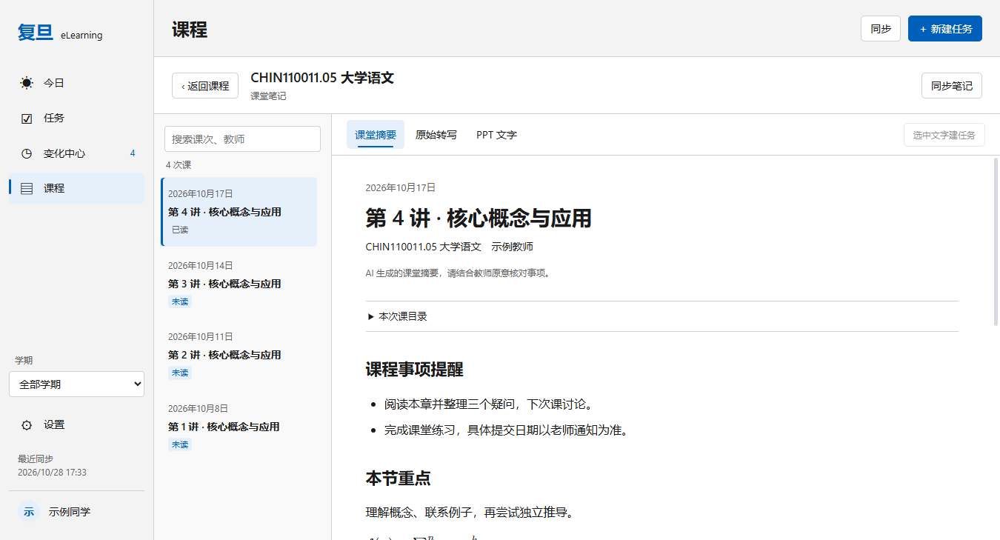
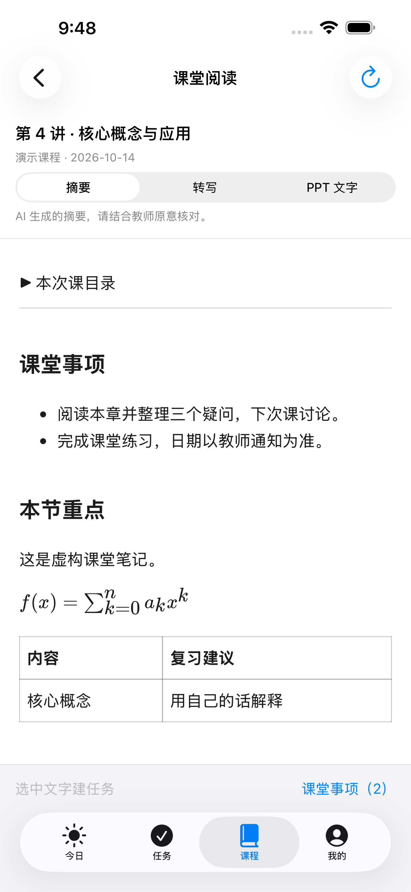
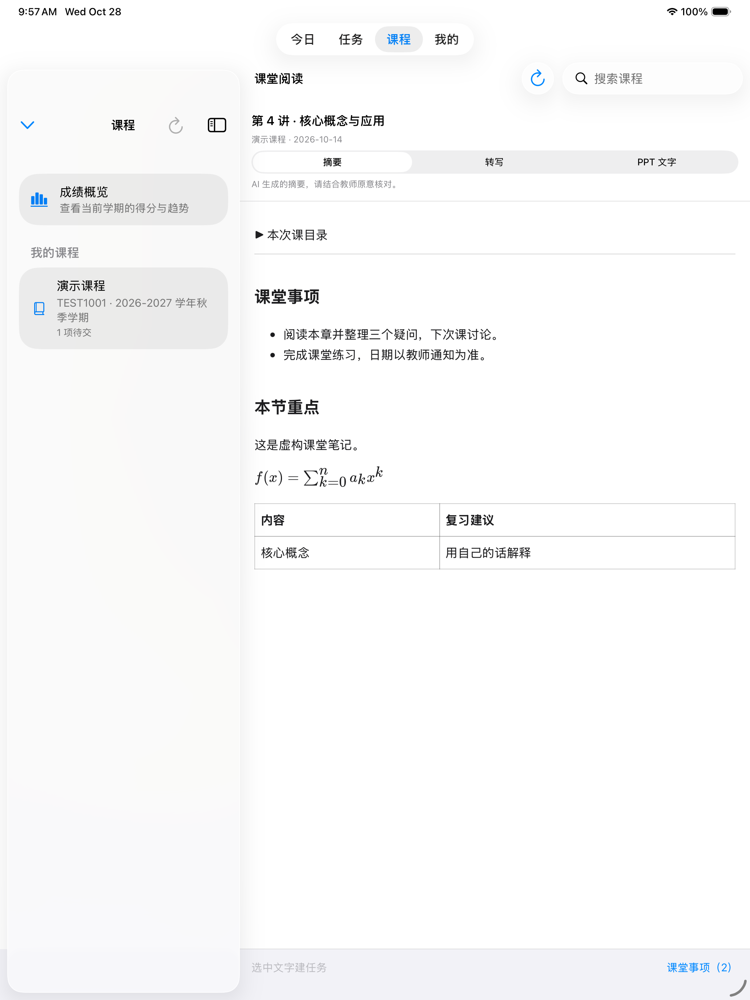

# Windows / iOS 稳定性与性能验证

验证日期：2026-10-28。评审：[PR #2](https://github.com/btr2309887446-code/fudan-elearning-dashboard/pull/2)，保留草稿，未合并主分支、未发布 Release。基于现有 iOS 分支，先通过 `9102d4b` 保存原有 Windows 工作区与课堂功能，再分批优化。

## 安装包与源码

运行源码：`ac40630d9080b3046341aa977d4119f5b305ce68`。后续验证文档和基准脚本提交不改变这些安装包。完整自动验证：[Actions 40665549417](https://github.com/btr2309887446-code/fudan-elearning-dashboard/actions/runs/40665549417)，Windows 与 iOS 均成功。

| 产物 | 版本 | 本地交付路径 | 字节数 |
| --- | --- | --- | --- |
| Windows x64 NSIS | 0.12.0 | `release/stability-ac40630/Fudan-eLearning-Dashboard-0.12.0-setup.exe` | 141466528 |
| iOS 未签名 IPA | 1.2.1 (7) | `release/stability-ac40630/ios/stability-package/Fudan-eLearning-iOS-stability-unsigned.ipa` | 4039624 |

Windows 本地包 SHA-256：`66929b94f8ddf2a17c1eacc3c1643e9e6396d130250fad8f64f44ac84b853202`。

iOS 包 SHA-256：`73c007d97e128ccba1b11f815323c112fc35ac519c8118ecea2e0cfdd9585b7b`。

两包旁均附版本、源码 SHA、大小、SHA-256 清单。Windows 本地与 CI 独立打包，安装包字节可能不同，各自以随包清单为准。IPA 已解包核对：`cn.edu.fudan.fudanElearning`、最低 iOS 15、支持 iPhone/iPad、无签名。Windows 安装标识仍为 `cn.edu.fudan.elearning.dashboard`。

Actions 产物包含 `windows-validation`、`ios-delivery`、`ios-test-results`，日志、完整截图及测试结果保留 14 天；大安装包不进入 Git。IPA 需自行签名后安装。

## 实现范围

- Windows Cookie 与 AI 密钥改为系统安全存储；iOS Cookie 从 UserDefaults 迁到设备专属 Keychain。迁移必须写入和回读成功后才清理旧文件及备份，失败保留数据并提示。备份单独残留也可恢复，明确清除的凭据不会由备份重新导入。
- 公开设置使用白名单，AI 设置只返回是否已有密钥，记住密码只返回保存状态。桌面渲染沙箱开启，IPC 验证发送窗口、主框架与参数，限制内页导航和文件定位路径，外链统一经 HTTPS 入口。
- 两端使用可注入时钟，按北京时间判定日期；每分钟、回到前台及恢复时刷新派生状态，跨天不触发网络全量刷新，也不重置表单。
- 课堂源保存上次提交及待恢复状态。同一健康提交只查询上游引用，不下载或重写分片；失败分片和变化保存失败仍会重试。损坏清单不阻断完好正文，重新同步能修复清单。
- Windows 连接配置采用单一版本化记录；保存新清单成功后保留当前、前一份成功清单及使用中的分片，再清理旧缓存。来源和账号隔离。
- 两端独立加密课次索引，正文数据库按需打开并淘汰。Windows 预算 128 MiB，iOS 64 MiB；单个超预算分片查询完成即释放。iOS 下载分块接收并检查大小、取消状态。
- Electron 45.0.0、electron-builder 26.18.0、electron-vite 6.0.0、Vite 8.3.5、React 插件 6.1.2，React 保持 18。成绩图表、设置、Markdown/公式按需加载；正常窗口恢复后台节流。
- 手动发布先验证标签并解析为提交 SHA，各构建检出该 SHA；Windows/iOS 可分别选择构建，并生成产物清单。本轮仅运行验证工作流。

## 已通过的验证

Windows 类型检查、全部领域回归、模拟登录协议、45 项课堂内容检查通过。覆盖月末/闰年重复任务、任务完成撤销、账号切换、离线和部分同步失败、首次基线、相同提交重试、清单损坏恢复及 5,000 条课次分页。

12 组工作区界面和 9 组课程界面通过，含深浅色、800×600、1366/1920 宽度、125%/150% 缩放、减少动态效果、5,000 项任务、保存失败保留草稿、来源返回、公式与表格。真实 Windows 安全存储额外覆盖主设置加备份、仅备份、已清除密钥仍有旧备份三种情况，以及隔离边界和前台跨日保留草稿。

本地打包程序已验证课程阅读、任务创建、设置、变化跳转，以及关闭到托盘、恢复窗口、完全退出。系统支持通知不等于已验证通知实际投递。

iPhone 15 Plus 与 iPad Pro 13-inch (M5) 模拟器各通过 **40 项核心测试 + 1 条课堂阅读与任务创建流程**，随后设备 Release 构建成功。核心测试包括 Keychain 适配器失败/迁移、课堂缓存预算、损坏清单恢复；UI 附件中的公式与表格已人工查看。

`npm audit` 为 0 项已知漏洞。ECharts 升到 6.1.0、KaTeX 统一为 0.19.1，公式与图表回归通过。Electron 45 对同步 safeStorage 查询有弃用提示，当前接口仍可用；后续可单独迁移异步接口。

## 性能记录与范围

| 指标 | 基线 | 优化后 |
| --- | --- | --- |
| 原基线构建首页入口 JS | 3825.13 kB | 331.74 kB |
| 同环境重建后启动中位耗时，3 次 | 400.98 ms | 291.39 ms |
| 隐藏窗口总工作集，3 次均值 | 424.4 MiB | 373.1 MiB |
| 隐藏窗口 CPU，短采样平均 | 0.030% | 0.022% |

启动比较使用 `9102d4b` 与 `ac40630`，同机、同 Electron 45 与当前依赖重建、全新虚构用户目录。测量从主进程脚本开始到工作区挂载，不含操作系统启动进程时间；不是旧版 Electron 与新版的冷启动对比。窗口隐藏后稳定 2 秒，再每 2 秒采样，共 6 次。CPU 接近空闲，短采样不支持更广泛的节电结论。复现入口：`scripts/benchmark-startup.cjs`；要求显式指定演示目录、主进程入口和输出文件。

Windows 三个各 52,899,840 字节的数据库轮流查询，常驻最多两个，共 105,799,680 字节；正文打开约 74–75 ms。测试进程采样峰值 RSS 为 406,618,112 字节，包含夹具生成、WASM 容量和临时解压缓冲。

iOS 三个各 39,677,952 字节的数据库轮流查询，常驻一个，低于 64 MiB。iPhone 模拟器正文打开 172–191 ms，iPad 91–120 ms；测试进程最大 RSS 分别约 483/485 MiB。数据库预算不代表整个进程内存上限，模拟器结果不代表真机峰值。完整指标随 iOS 测试附件保存。

健康同提交检查：仅 1 次引用请求，缓存文件修改时间不变；变化保存失败时只重试事件持久化，不重复下载。索引恢复后正文数据库常驻数为 0。

## 尚需现场验收

本轮未覆盖真实账号登录/私有笔记源、用户当前安装的就地升级、iPhone/iPad 真机、真实系统通知投递及实际电脑睡眠恢复。已测试合成旧数据迁移与模拟恢复事件，但不能替代这些现场项目。未自动覆盖用户正在使用的旧安装，也未将模拟器截图标为实机截图。

## 精选截图（全为虚构数据）

